<p align="center">
  
</p>

<p align="center">
  
</p>

<p align="center">
  <a href="https://github.com/sponsors/inomisay"></a>
  <a href="https://inomisay.vercel.app"></a>
  <a href="https://www.linkedin.com/in/yasamin-valishariatpanahi/"></a>
</p>

### `> whoami`

Computer Engineer, B.Sc. from Dokuz Eylül University, now doing my M.Sc. in Computer Engineering there.
I work on software, machine learning and AI, and I like taking research out of the paper and into something people can run.

```txt
[ NOW      ] Speech Emotion Recognition (my master's thesis)
[ LEARNING ] Audio processing · Image processing · LLM security · MLOps
[ OPEN TO  ] Open-source AI and software engineering projects
[ NEED     ] Help with production-ready AI, cloud infra, research collabs
[ ASK ME   ] Machine learning · Python · FastAPI · Node.js · software engineering
[ PRONOUNS ] she/her
[ MOTTO    ] The best way to learn is to build.
```

### `> languages --list`

| Language | Level | |
|:--|:--|:--|
| 🇮🇷 Persian | Native | `▰▰▰▰▰` |
| 🇹🇷 Turkish | C1 | `▰▰▰▰▱` |
| 🇬🇧 English | C1 | `▰▰▰▰▱` |
| 🇩🇪 German | B1 | `▰▰▱▱▱` |

### `> stack --installed`

<p align="center">
  
</p>

### `> stats --me`

<p align="center">
  
  
</p>

<p align="center">
  
</p>

<picture>
  <source media="(prefers-color-scheme: dark)" srcset="https://raw.githubusercontent.com/inomisay/inomisay/output/github-snake-dark.svg">
  <source media="(prefers-color-scheme: light)" srcset="https://raw.githubusercontent.com/inomisay/inomisay/output/github-snake.svg">
</picture>

### `> support --me`

If something I made saved you time, you can back my open-source work on GitHub Sponsors. It goes straight into more tools, more datasets and more late-night debugging.

<p align="left">
  <a href="https://github.com/sponsors/inomisay"></a>
</p>

### `> contact`

<p align="left">
  <a href="https://www.linkedin.com/in/yasamin-valishariatpanahi/" target="_blank" rel="noopener noreferrer"></a>
  <a href="https://inomisay.vercel.app" target="_blank" rel="noopener noreferrer"></a>
  <a href="mailto:jmvshp@gmail.com"></a>
  <a href="https://instagram.com/inomisay" target="_blank" rel="noopener noreferrer"></a>
  <a href="https://pinterest.com/inomisay" target="_blank" rel="noopener noreferrer"></a>
</p>

<p align="center">
  
</p>

<p align="center"><sub><code>[ press ★ to continue ]</code> · made by <a href="https://github.com/inomisay">inomisay</a></sub></p>
